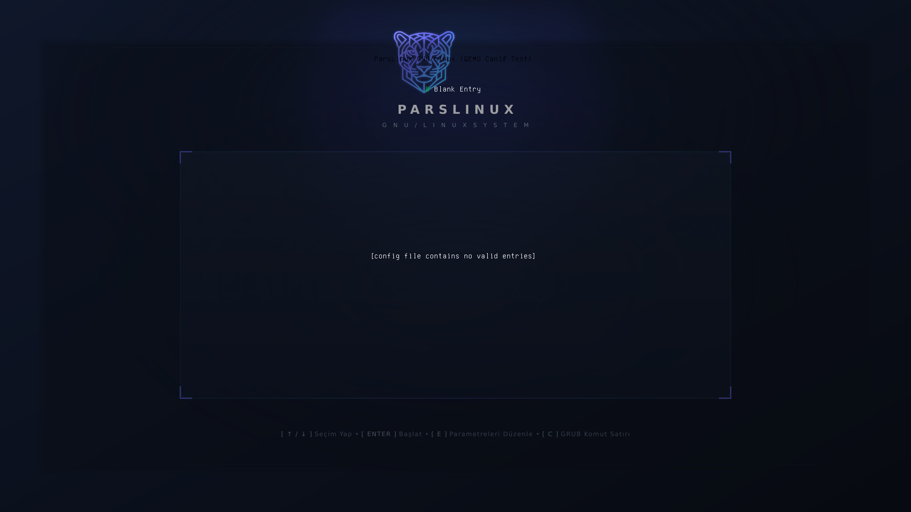

# 🐆 ParsLinux Limine Teması (`parslinux-limine-theme`)

Modern, şık ve yüksek çözünürlüklü ekranlar (Full HD, 2K, 4K) için özel olarak tasarlanmış resmi **ParsLinux Limine Önyükleme Teması**.

Bilgisayar açılırken klasik siyah veya varsayılan metin tabanlı Limine ekranı yerine, ParsLinux Anadolu Parsı amblemi, neon siber hatlar ve zarif yarı saydam (*glassmorphic*) terminal paneli ile üst düzey bir karşılama sunar.

---

## ✨ Özellikler

- 🌟 **Yüksek Çözünürlüklü Görsel Deneyim**: 1920x1080 yerel çözünürlük; 16:9, 16:10 ve ultra geniş monitörlerde otomatik ölçeklenme (`stretched` / `centered`).
- 🐆 **Resmi ParsLinux Markalama**: İnce işlenmiş Pars geometrik amblemi, neon camgöbeği/eflatun hatlar ve tipografi.
- 🎨 **Özel Terminal Renk Paleti**:
  - Yarı saydam (`99080b12`) terminal arka planı ile alttaki Pars görselinin görünürlüğü.
  - Okunabilirliği yüksek beyaz yazı tipi ve camgöbeği (`#38bdf8`) odak/vurgu rengi.
  - 16 renkli dengeli ANSI renk paleti (`term_palette`, `term_palette_bright`).
- 📐 **Zarif Menü Yerleşimi**:
  - Dengeli kenar boşlukları (`term_margin: 96`)
  - Yumuşak gradyan kenarlık geçişi (`term_margin_gradient: 16`)
- 📦 **Evrensel Kurulum ve Paketleme**:
  - Tek tıkla çalışan akıllı kurulum sihirbazı (`install.sh`)
  - Güvenli yedekleme ve kaldırma betiği (`uninstall.sh`)
  - Debian/Ubuntu uyumlu `.deb` paketi ve bağımsız dağıtım arşivi (`.tar.gz`).
  - Terminal tabanlı yönetim ve test arayüzü (`run.sh`).

---

## 📸 Ekran Önizlemesi



```text
┌──────────────────────────────────────────────────────────────────────────────┐
│                                                                              │
│                                   [ 🐆 ]                                     │
│                        PARSLINUX  GNU/LINUX  SİSTEMİ                         │
│                                                                              │
│   ┌──────────────────────────────────────────────────────────────────────┐   │
│   │                                                                      │   │
│   │  > 1. ParsLinux GNU/Linux (Varsayılan Çekirdek)                      │   │
│   │    2. ParsLinux GNU/Linux (Kurtarma / Onarım Kipi)                   │   │
│   │    3. Windows Boot Manager                                           │   │
│   │    4. UEFI Donanım Yazılımı Ayarları                                 │   │
│   │                                                                      │   │
│   └──────────────────────────────────────────────────────────────────────┘   │
│                                                                              │
│      Seçili: ParsLinux GNU/Linux (Varsayılan Çekirdek)                       │
│      [ ↑ / ↓ ] Seç  •  [ Enter ] Başlat  •  [ E ] Düzenle                    │
│      Otomatik başlatmaya kalan süre: 5 saniye                                │
│                                                                              │
└──────────────────────────────────────────────────────────────────────────────┘
```

---

## 🚀 Kurulum

### Yöntem 1: Hızlı Kurulum Betiği (Önerilen)

Depo dizininde kurulum betiğini root haklarıyla çalıştırın:

```bash
git clone https://github.com/parslinux/parslinux-Limine-theme.git
cd parslinux-Limine-theme
sudo ./install.sh
```

Betik otomatik olarak:
1. Mevcut `limine.conf` yapılandırmanızı tespit eder.
2. Zaman damgalı bir yedek oluşturur (`limine.conf.bak.*`).
3. Tema dosyalarını `/boot/limine/themes/parslinux` ve `/usr/share/limine/themes/parslinux` konumlarına yerleştirir.
4. Tema direktiflerini `limine.conf` dosyanıza güvenli şekilde uygular.

---

### Yöntem 2: Debian Paketi (`.deb`) ile Kurulum

```bash
# Paketi derleyin:
./package.sh

# Paketi kurun:
sudo dpkg -i build/parslinux-limine-theme_1.0.0_all.deb
```

---

### Yöntem 3: Manuel (Elle) Yapılandırma

Tema dosyalarını kopyaladıktan sonra `/boot/limine.conf` dosyanızın en üst kısmına şu bloğu ekleyin:

```conf
### BEGIN PARSLINUX LIMINE THEME ###
interface_resolution: 1920x1080
interface_branding: ParsLinux GNU/Linux
interface_branding_color: 6
interface_help_hidden: no

wallpaper: boot():/limine/themes/parslinux/background.png
wallpaper_style: stretched
backdrop: 080b12

term_background: 99080b12
term_foreground: ffffff
term_background_bright: 80161b26
term_foreground_bright: 38bdf8
term_margin: 96
term_margin_gradient: 16

term_palette: 080b12;ef4444;10b981;f59e0b;3b82f6;8b5cf6;06b6d4;cbd5e1
term_palette_bright: 475569;f87171;34d399;fbbf24;60a5fa;a78bfa;22d3ee;ffffff
### END PARSLINUX LIMINE THEME ###
```

---

## ⚡ `update-limine` Aracı ve Çekirdek Kancaları

ParsLinux Limine Teması, GRUB'daki `update-grub` benzeri tam otomatik bir yapılandırma üretici içerir:

* **`/usr/sbin/update-limine`**: `/boot` altındaki çekirdekleri (`vmlinuz-*`), ramdisk imajlarını (`initrd.img-*`), Windows Boot Manager ve UEFI ayarlarını tarar, temayı uygulayarak `limine.conf` dosyasını otomatik üretir.
* **`/etc/default/limine`**: Zaman aşımı süresi, çözünürlük, varsayılan girdi ve çekirdek parametrelerini merkezi olarak yapılandırmanızı sağlar.
* **`/etc/kernel/postinst.d/zz-update-limine`**: Sistemde yeni bir Linux çekirdeği kurulduğunda veya güncellendiğinde menüyü otomatik olarak günceller.

```bash
# Yapılandırmayı elle yenilemek için:
sudo update-limine
```

---

## 🛠️ Yönetim ve Test Aracı (`run.sh`)

Tema bütünlüğünü test etmek, önizleme görüntülemek veya işlem yapmak için `run.sh` aracını kullanabilirsiniz:

```bash
# Etkileşimli yönetim menüsünü açar:
./run.sh

# Tema dosyalarını, araçları ve direktifleri doğrular:
./run.sh --check

# Terminal ASCII önizlemesini görüntüler:
./run.sh --preview

# Debian ve tar.gz paketlerini derler:
./run.sh --package
```

---

## 🗑️ Temayı Kaldırma

Temayı ve kancaları sistemden tamamen temizlemek için:

```bash
sudo ./uninstall.sh
```

---

## 📂 Dizin Yapısı

```text
parslinux-Limine-theme/
├── bin/                       # Sistem yürütülebilir araçları
│   └── update-limine          # limine.conf otomatik üretim aracı (update-grub dengi)
├── etc/                       # Yapılandırma ve kancalar
│   ├── default/limine         # Merkezi Limine seçenekleri (timeout, cmdline vb.)
│   └── kernel/post*.d/        # Çekirdek güncelleme kancaları (zz-update-limine)
├── parslinux/                 # Limine tema çekirdeği
│   ├── background.png         # 1920x1080 Full HD ParsLinux duvar kağıdı
│   ├── parslinux.f16          # 4096 baytlık ham CP437 konsol yazı tipi (8x16)
│   ├── theme.conf             # Tema konfigürasyon direktifleri
│   └── limine_sample.conf     # Örnek hazır limine.conf dosyası
├── debian/                    # Debian paketleme dosyaları
├── docs/                      # Mimari, kurulum ve test kılavuzları
├── screenshots/               # Önizleme görselleri
├── install.sh                 # Otomatik kurulum sihirbazı
├── uninstall.sh               # Kaldırma betiği
├── package.sh                 # Paketleme aracı (.deb ve .tar.gz)
├── run.sh                     # Yönetim ve test konsolu
├── Makefile                   # Sistem kurulum yönergeleri
└── README.md                  # Bu belge
```

---

## 📜 Lisans

Bu proje **GNU General Public License v3.0 (GPL-3.0)** kapsamında lisanslanmıştır.  
Telif Hakkı (C) 2026 ParsLinux Geliştirici Ekibi &lt;dev@parslinux.org&gt;.
